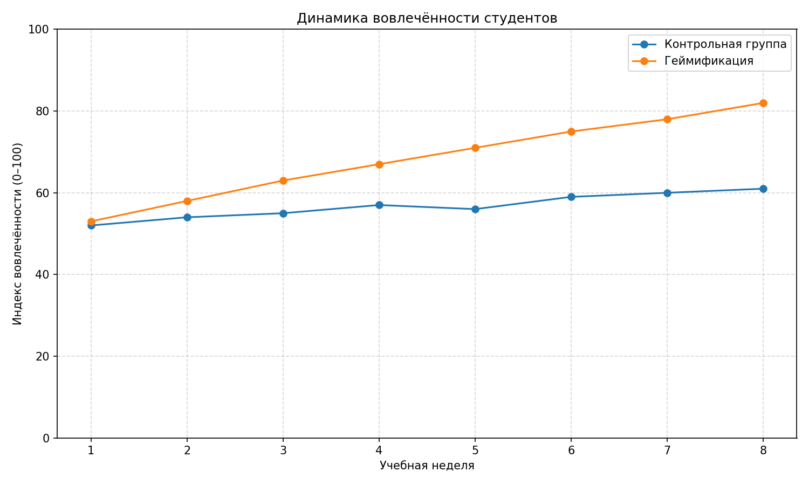

# Лабораторная работа

## Генераторы статических сайтов для публикации результатов исследований

Цель данной лабораторной работы — изучить инструменты генерации статических сайтов, освоить автоматизацию сборки и публикации веб-страниц, а также организовать воспроизводимый процесс представления результатов научных экспериментов.

## Направления работы

В рамках лабораторной работы рассматриваются:

- генераторы статических сайтов (SSG);
- подготовка и обработка экспериментальных данных с помощью Python;
- автоматическая генерация таблиц и графиков;
- интеграция обработки данных с генерацией сайта;
- автоматизация сборки и публикации сайта с использованием CI/CD.

## Выбранные технологии

| Инструмент | Назначение |
|---|---|
| Python | Обработка и анализ данных |
| MkDocs | Генерация статического сайта |
| Material for MkDocs | Оформление сайта |
| Git | Контроль версий |
| GitHub Actions | Автоматизация сборки и публикации |

## Структура лабораторной работы

В ходе работы будет реализован конвейер, позволяющий преобразовать исходные экспериментальные данные в графики и таблицы, автоматически включить их в сайт и опубликовать итоговые результаты.

---

## Анализ учебной вовлечённости

В рамках демонстрационного эксперимента сравнивается динамика вовлечённости студентов в контрольной группе и группе, использующей геймифицированную учебную платформу.

### Динамика вовлечённости

На графике представлены изменения индекса вовлечённости в течение восьми учебных недель.

### Описание эксперимента

- Контрольная группа — обучение без игровых механик.
- Геймифицированная группа — обучение с использованием игровых элементов и визуализации прогресса.

Данные являются синтетическими и используются для демонстрации автоматизированной обработки, анализа и визуализации результатов.

