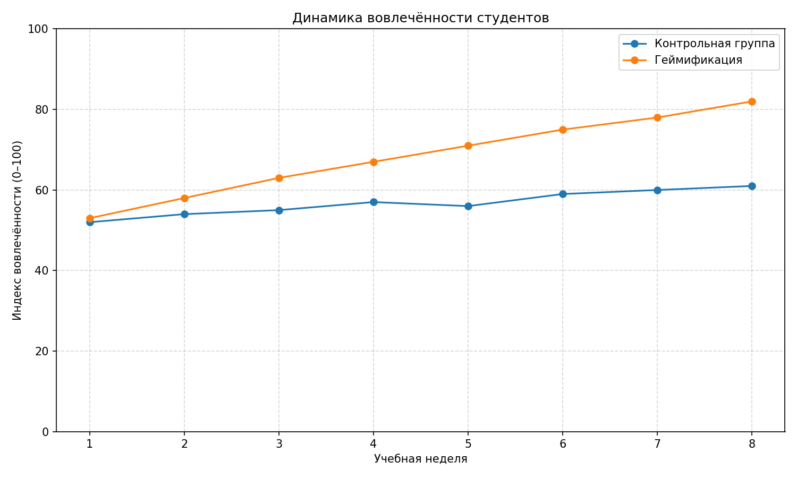

# Визуализация результатов эксперимента

## 1. Назначение визуализации

Визуализация данных позволяет представить результаты эксперимента в графическом виде, облегчает сравнение показателей и помогает выявлять закономерности их изменения во времени.

В данном проекте используется график динамики условного показателя вовлечённости студентов в двух группах: контрольной и геймифицированной.

## 2. Динамика вовлечённости

На графике представлены значения Engagement Score за восемь учебных недель. Сравниваются две группы:

- **Control** — контрольная группа, без игровых элементов.
- **Gamified** — группа с условными игровыми элементами.

## 3. Анализ графика

По представленным модельным данным наблюдаются следующие тенденции:

- В контрольной группе показатель вовлечённости изменяется постепенно, без резких скачков.
- В геймифицированной группе наблюдается более выраженный рост показателя на протяжении восьми недель.
- Разница между группами увеличивается к концу рассматриваемого периода.
- В геймифицированной группе модельный показатель достигает более высокого значения на последней неделе.

Полученная визуализация демонстрирует, как графическое представление помогает сравнивать динамику двух наборов данных и выделять различия в тенденциях.

## 4. Интерпретация

В рамках модельного эксперимента динамика геймифицированной группы показывает более выраженное увеличение условного показателя вовлечённости по сравнению с контрольной группой.

Данный результат иллюстрирует возможности сравнительного анализа данных, однако не является доказательством реального влияния геймификации на студентов. Для подтверждения подобной гипотезы необходим эксперимент с реальными участниками, корректным сбором данных и статистической проверкой результатов.

## 5. Используемые технологии

Для построения графика применяются:

- Python — обработка исходных данных;
- Pandas — работа с табличными данными;
- Matplotlib — построение графиков;
- CSV — формат хранения данных;
- MkDocs — публикация результатов на веб-сайте.

График создаётся автоматически скриптом `scripts/plot.py` на основе исходного файла `data/measurements.csv`.

## 6. Вывод

Графическое представление результатов позволяет наглядно оценивать динамику показателей и сравнивать контрольную и геймифицированную группы. Автоматическая генерация графика обеспечивает воспроизводимость визуализации при изменении исходных данных и упрощает обновление исследовательского сайта.